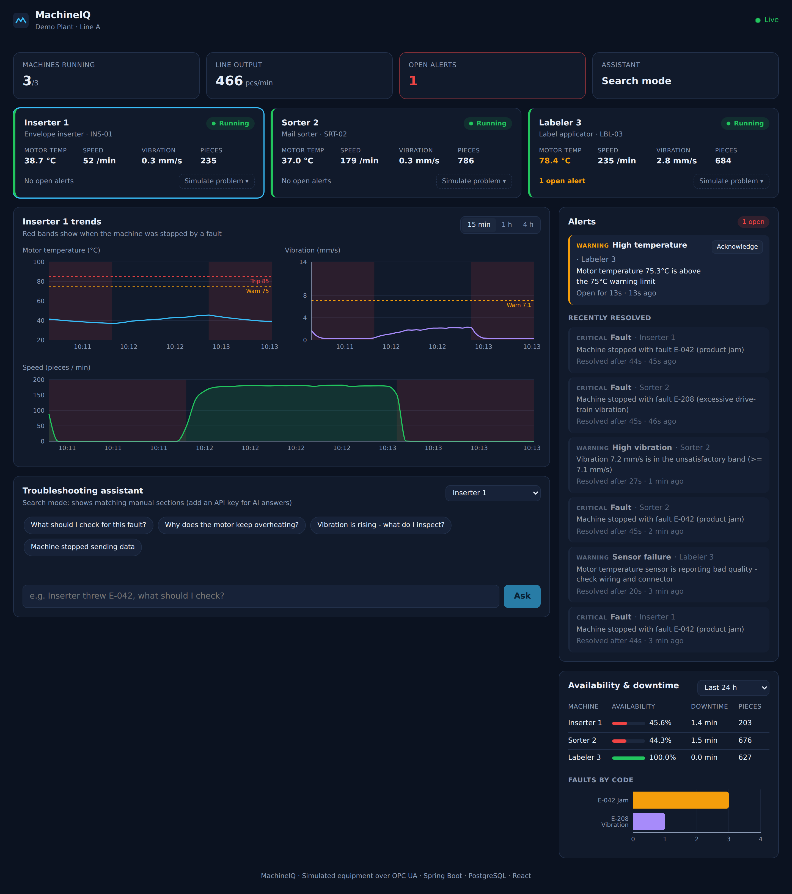

# MachineIQ

**Industrial machine monitoring and AI fault diagnosis.**
MachineIQ reads live data from production machines over **OPC UA**, detects problems before
they stop the line, tracks availability and downtime, and gives technicians a troubleshooting
assistant that answers from the equipment manuals.

[](https://github.com/ahmedali202222/MachineIQ/actions/workflows/ci.yml)



## Why I built it

I work as a machine and controls technician, troubleshooting PLC-connected production equipment.
When a machine stops, the questions are always the same: *what faulted, has it happened before,
and what's the fix?* The answers are spread across the HMI, paper logs and thick manuals.
MachineIQ puts them in one place, and warns you about overheating motors and worn bearings
before they become a stopped line.

## What it does

- **Live machine status** for every machine on the line: running/faulted/offline, motor
  temperature, speed, vibration and piece count, updated every second.
- **Early-warning rules**: alerts when a motor passes 75 °C (before the 85 °C trip), when vibration
  enters the ISO 10816 "unsatisfactory" band, when a sensor reports bad quality, or when a machine
  stops sending data. Hysteresis prevents alert flapping.
- **Fault tracking**: every controller fault (jam, over-temperature, vibration) is logged with how
  long it lasted, and alerts can be acknowledged.
- **Availability & downtime** per machine for the last hour, shift, day or week, plus faults by code
  to spot repeat problems.
- **Troubleshooting assistant (RAG)**: ask "Inserter threw E-042, what should I check?" and it pulls
  the matching manual sections with PostgreSQL full-text search, adds the machine's live status, and
  has an LLM write step-by-step instructions that cite the manual. Without an API key it still works
  in search mode and shows the relevant sections.
- **Demo controls**: trigger a jam, overheating motor, worn bearing or sensor dropout from the
  dashboard and watch MachineIQ react.

## Architecture

```mermaid
flowchart LR
    subgraph Plant floor
        SIM["Machine simulator<br/>(Python, asyncua)<br/>3 machines as OPC UA server"]
    end
    subgraph MachineIQ backend - Spring Boot, Java 21
        COL["OPC UA collector<br/>(Eclipse Milo)<br/>reads tags every 1 s"]
        RULES["Rules engine<br/>alerts + hysteresis"]
        API["REST API"]
        RAG["Assistant<br/>retrieval + LLM"]
    end
    DB[("PostgreSQL<br/>readings, alerts,<br/>manual index")]
    UI["React dashboard<br/>(Vite, Recharts)"]
    LLM["Anthropic API<br/>(optional)"]

    SIM -- "OPC UA (opc.tcp)" --> COL --> RULES --> DB
    COL --> DB
    API --> DB
    RAG --> DB
    RAG -.-> LLM
    UI -- "/api" --> API
    API --> RAG
```

1. The **simulator** behaves like three PLCs (an inserter, a sorter and a labeler). It publishes
   their tags over OPC UA, the standard protocol modern PLCs and plant gateways use, and creates
   realistic problems: gradual overheating, random jams, bearing wear and sensor dropouts.
2. The **collector** connects to the OPC UA server, reads all tags in one request every second,
   and stores them. It is read-only: it never writes to a controller.
3. The **rules engine** turns readings into alert open/close events. It's plain Java with no
   framework code, so it's fully unit tested.
4. The **dashboard** polls the API and shows status, trends with fault periods shaded, alerts,
   availability and the assistant.

## Run it

You need [Docker Desktop](https://www.docker.com/products/docker-desktop/).

```bash
git clone https://github.com/ahmedali202222/MachineIQ.git
cd MachineIQ
docker compose up --build
```

Open **http://localhost:3000**. Data starts flowing within a few seconds. Use **Simulate problem**
on a machine card to cause a fault.

**Optional: AI answers.** Copy `.env.example` to `.env`, add an
[Anthropic API key](https://console.anthropic.com/) and restart. Without a key the assistant runs in
search mode at no cost.

### Run the pieces individually (for development)

```bash
# 1. Database
docker compose up -d db

# 2. Simulator (Python 3.11+)
cd simulator && pip install -r requirements.txt && python server.py

# 3. Backend (Java 21, Maven)
cd backend && mvn spring-boot:run

# 4. Dashboard (Node 20+) - http://localhost:5173
cd frontend && npm install && npm run dev
```

## Connecting a real machine

MachineIQ talks standard OPC UA, so pointing it at real equipment is configuration, not code.
In [`backend/src/main/resources/application.yml`](backend/src/main/resources/application.yml):

```yaml
machineiq:
  opcua:
    endpoint: opc.tcp://10.0.5.20:4840        # your PLC or gateway (e.g. Kepware, Ignition)
    namespace-uri: urn:your:plc:namespace
    tags:                                      # MachineIQ field -> tag name on the controller
      motorTempC: Drive_Motor_Temp
      faultCode: Active_Fault
      # ...
  machines:
    - id: INS-01
      name: Inserter 1
      kind: Envelope inserter
      node-prefix: Line1.Inserter1             # node id = prefix + "." + tag
```

On a real plant floor, connecting also needs approval from maintenance and IT/OT, network access to
the controller (usually through an edge gateway behind a firewall), and a **read-only** OPC UA
account. MachineIQ only ever reads.

## API

| Method | Path | Description |
|---|---|---|
| GET | `/api/machines` | Live status of every machine |
| GET | `/api/machines/{id}` | One machine's status |
| GET | `/api/machines/{id}/readings?minutes=15` | Trend data (downsampled for long windows) |
| GET | `/api/alerts?open=true` | Open alerts, or recent alerts without `open` |
| POST | `/api/alerts/{id}/ack` | Acknowledge an alert |
| GET | `/api/stats?hours=24` | Availability, downtime, pieces, faults by code |
| POST | `/api/assistant/ask` | `{"question": "...", "machineId": "INS-01"}` |
| POST | `/api/demo/inject/{id}/{jam\|overheat\|vibration\|dropout}` | Demo: cause a problem |

## Tests

| Part | What's tested | Run |
|---|---|---|
| Simulator | Machine physics, fault injection and recovery (pytest) | `cd simulator && pytest` |
| Backend | Rules engine, manual chunking, prompt building, and API integration tests against real PostgreSQL (JUnit 5) | `cd backend && mvn verify` |
| Dashboard | Lint and production build | `cd frontend && npm run lint && npm run build` |
| End to end | Starts the full stack with Docker Compose, causes a jam and a sensor dropout, and checks the alerts, status and assistant answer | `./scripts/e2e.sh` |

All of these run on every push in [GitHub Actions](.github/workflows/ci.yml).

## Design decisions

- **OPC UA instead of a custom protocol**: it's what real PLCs and gateways speak, so the collector
  is the same code you'd point at a production line.
- **Polling, not subscriptions**: one batched read per second is simple, predictable and easy to
  reason about for a handful of machines. OPC UA subscriptions would be the next step for hundreds
  of tags.
- **PostgreSQL full-text search for retrieval**: equipment manuals are short and full of exact terms
  (fault codes, part names) where keyword search works very well, with no extra vector database.
  Fault codes like `E-042` are normalized so the search parser doesn't split them.
- **The assistant is told to use only the provided manual excerpts** and to put safety steps first,
  because a made-up procedure on a factory floor is dangerous.
- **Alerts use hysteresis** (open at 75 °C, close below 72 °C) so a motor hovering at the limit
  doesn't create dozens of alerts.

## Project structure

```
simulator/   Python OPC UA server simulating three machines
backend/     Spring Boot API: collector, rules engine, assistant, PostgreSQL (Flyway)
  src/main/resources/manuals/   Equipment manuals the assistant searches
frontend/    React dashboard (Vite, Recharts)
scripts/     End-to-end test and screenshot capture
```

## Roadmap

- OPC UA subscriptions and certificate-based security
- Predictive maintenance: flag temperature and vibration trends before they cross a limit
- Shift reports by email
- Upload PDF manuals from the dashboard

---

Built by [Ahmed Ali](https://ahmedali202222.github.io/ahmedali-portfolio/). The equipment and
manuals in this repository are fictional and for demonstration only.
